# CCTI — Claude Code Type Indicator

> 🇫🇷 **Français** (vous êtes ici) · 🇬🇧 [English](README.md)

[](https://github.com/Sandjab/ccti/actions/workflows/ci.yml)
[](LICENSE)
[](https://sandjab.github.io/ccti)

> **Votre binôme Claude Code en 4 lettres : un test de personnalité à 16 types, pastiche du MBTI (Myers-Briggs Type Indicator).**
> Glissez votre dossier `~/.claude/projects` sur une page. Quatre axes mesurés vous classent dans
> l'un des seize types, dans l'esprit des tests à la MBTI. Vous obtenez aussi les compteurs que personne n'ose tenir, une facture en équivalent API, un diagnostic qui a des
> dents, et une carte à partager. Tout tourne dans votre navigateur. Rien n'est envoyé, jamais.

<picture>
  <source media="(prefers-color-scheme: dark)" srcset="assets/card-dark.png">
  
</picture>

**Essayez : [sandjab.github.io/ccti](https://sandjab.github.io/ccti)**, ou téléchargez la
[version hors ligne](https://sandjab.github.io/ccti/ccti.html), un seul fichier HTML.


## Pourquoi

Tous les outils de stats Claude Code comptent des tokens. Aucun ne compte combien de fois vous avez
dit *non*, combien de fois Claude vous a donné raison, ni combien de sessions vous avez terminées en
majuscules à deux heures du matin. CCTI, si. C'est un test de personnalité pour le couple que vous
formez avec Claude Code, avec une facture à la fin parce qu'il faut bien que quelqu'un le dise.

## Ce que vous obtenez

- **Votre type**, parmi seize, sur quatre axes mesurés : Contrôle / Autonomie, Laconique / Verbeux,
  Impulsif / Planificateur, Diurne / Nocturne.
- **Le couple** : les fois où Claude vous a donné raison (FR et EN, mème *You're absolutely right*
  compris), ses excuses, vos « non », vos majuscules, vos jurons, vos mercis, les interruptions, les
  outils refusés, les questions posées et celles auxquelles vous avez répondu, les rage-quits, votre
  part de la conversation, votre délai de réponse médian.
- **Les chiffres** : sessions, projets, messages, appels d'outils, sous-agents, jours actifs, série
  record, plus longue session, temps de travail total de Claude.
- **Les moments** : messages par heure et par jour, après 21 h, après minuit, nuits blanches.
- **Le danger** : `rm -rf`, `push --force`, `reset --hard`, `sudo`, commits.
- **La facture** : tokens par modèle et ce que ça aurait coûté au tarif API public, cache compris.
- **Un diagnostic** avec jusqu'à cinq observations, et une carte 1200×900 (PNG, presse-papiers) à partager.

## Les seize types

Quatre axes à deux pôles, une lettre par axe. CCTI est un projet indépendant, qui n'est affilié ni à Anthropic ni à The Myers-Briggs Company. Claude est une marque d'Anthropic ; MBTI et Myers-Briggs Type Indicator sont des marques de The Myers-Briggs Company.

<table>
  <tr><td>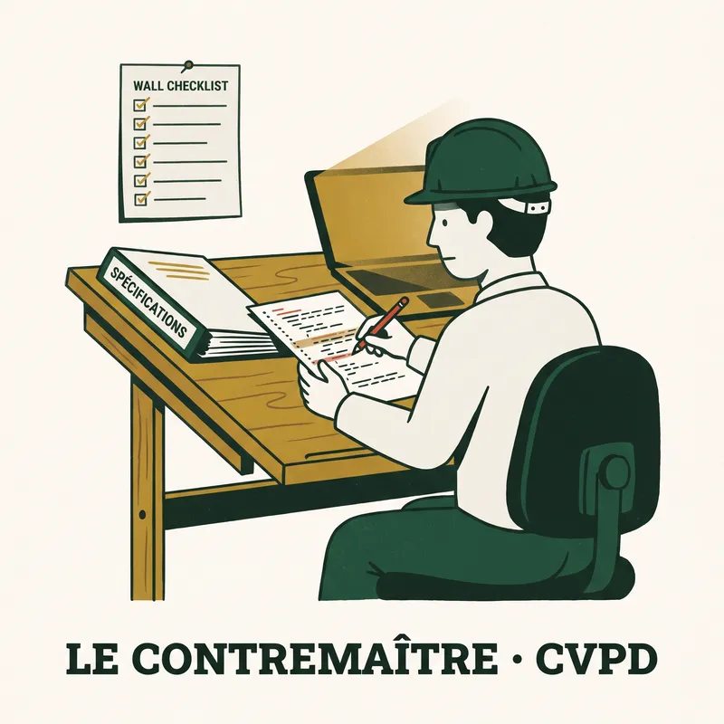</td><td>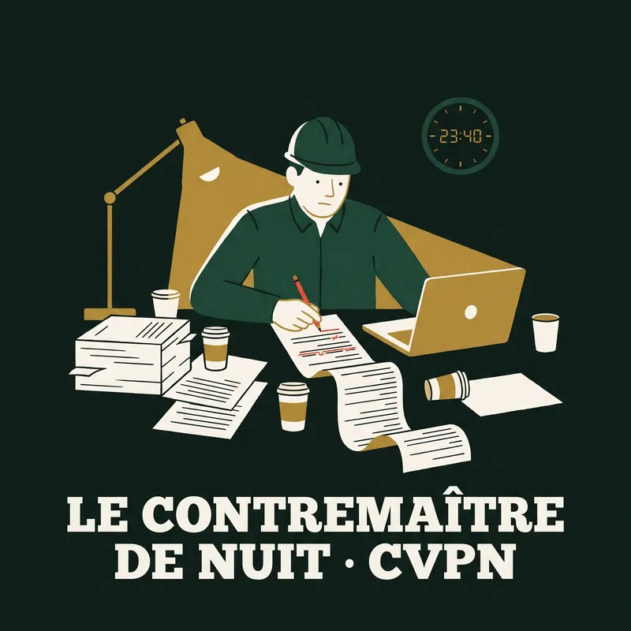</td><td>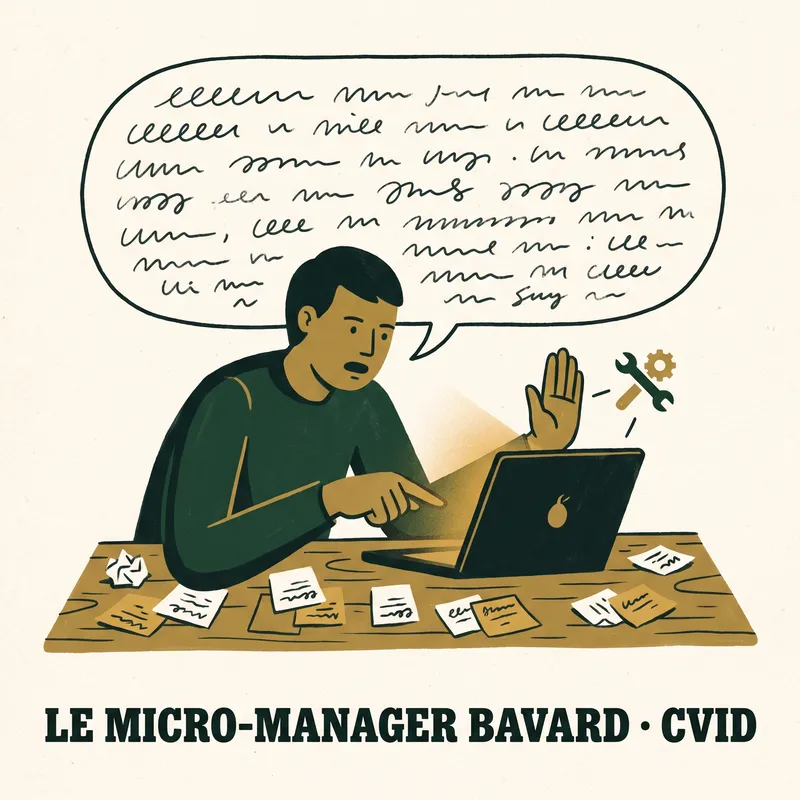</td><td>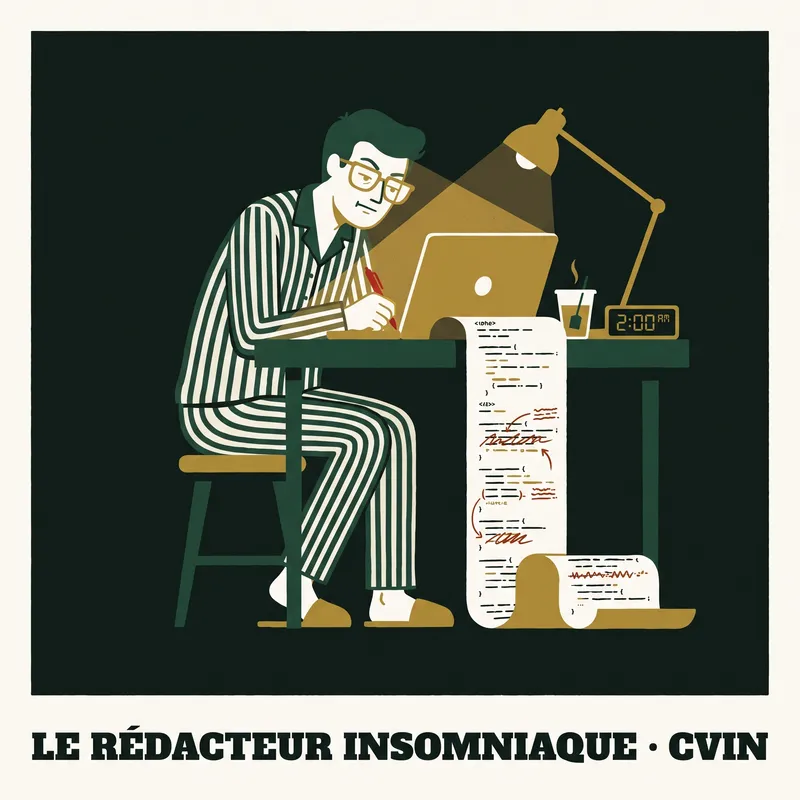</td></tr>
  <tr><td>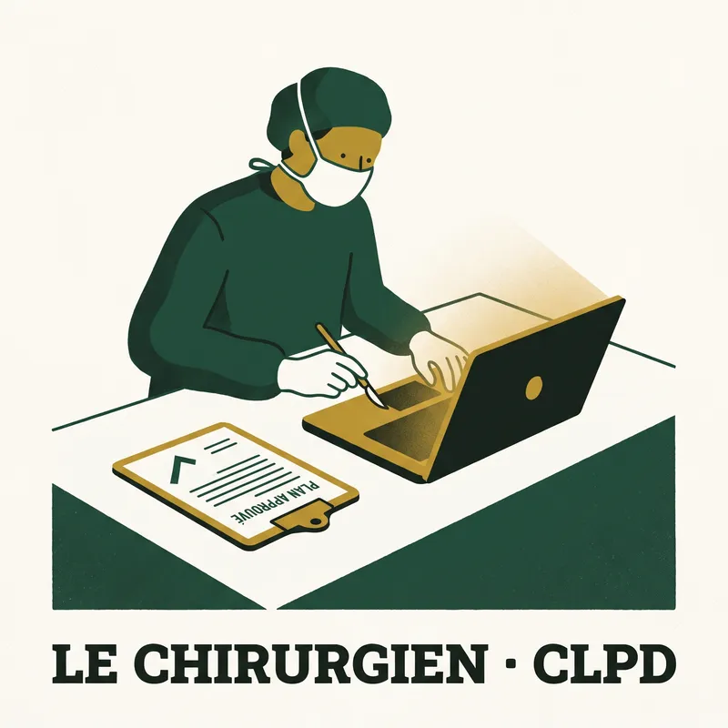</td><td>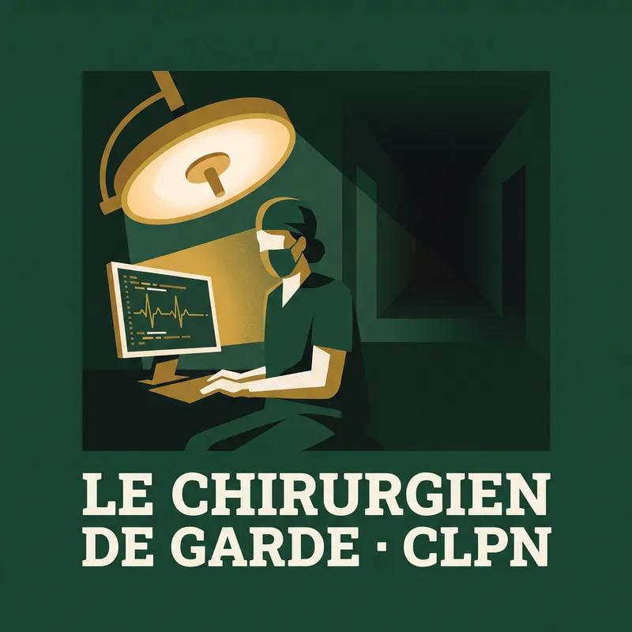</td><td></td><td>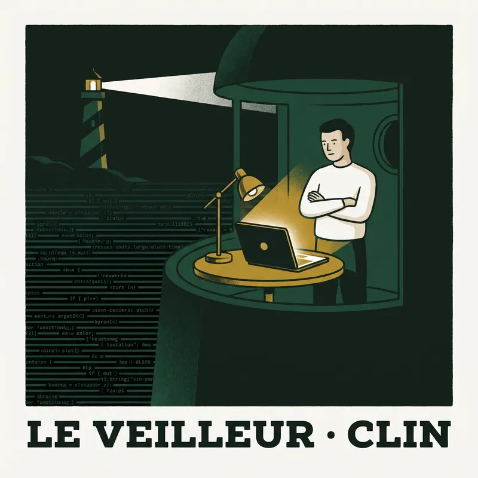</td></tr>
  <tr><td>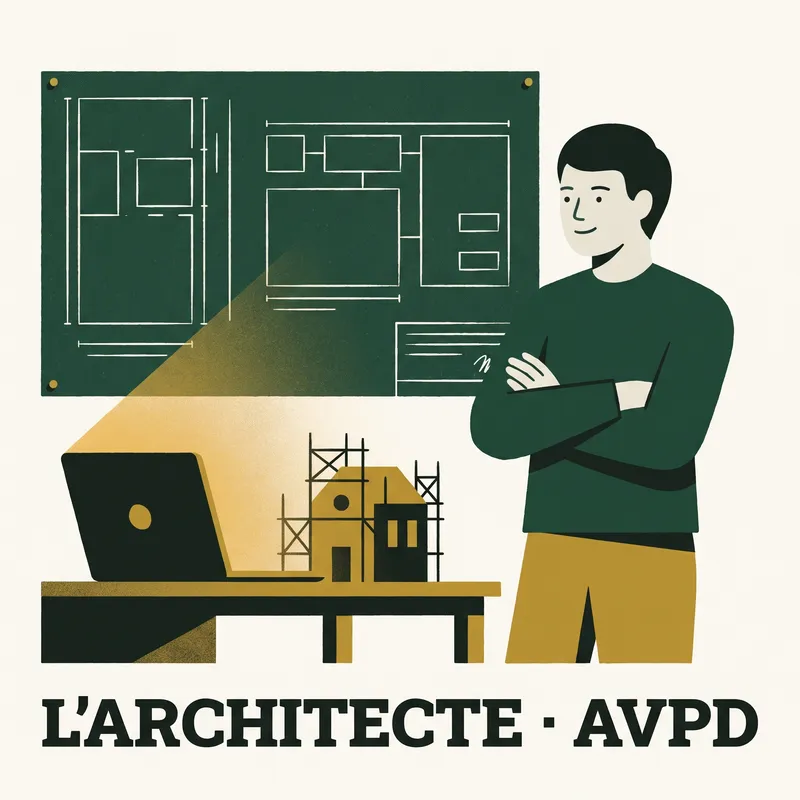</td><td>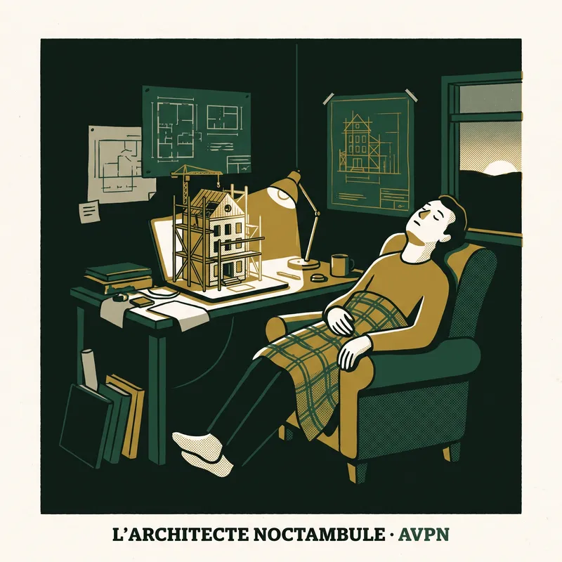</td><td></td><td>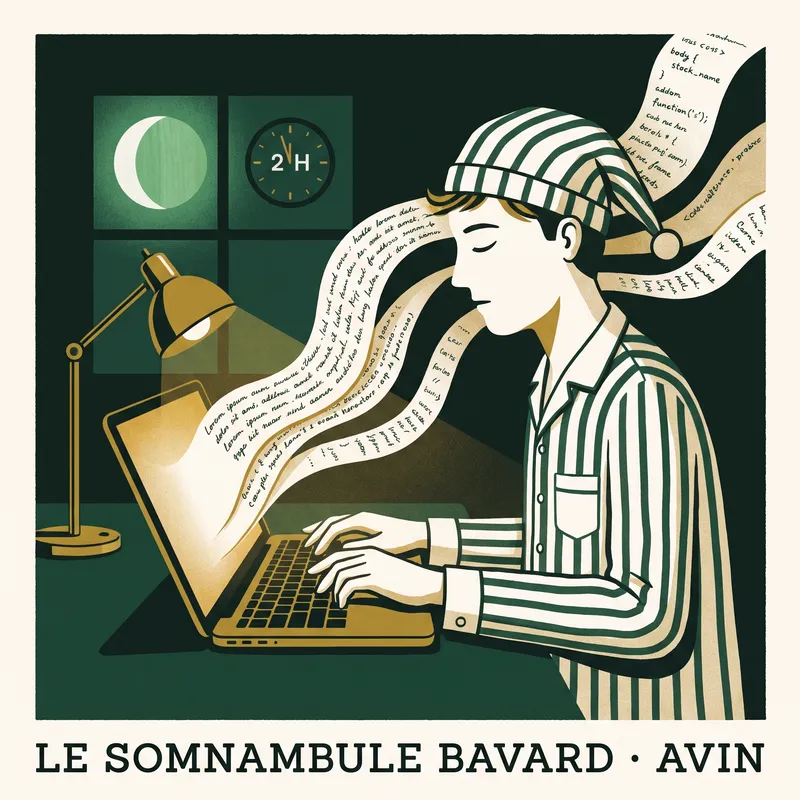</td></tr>
  <tr><td>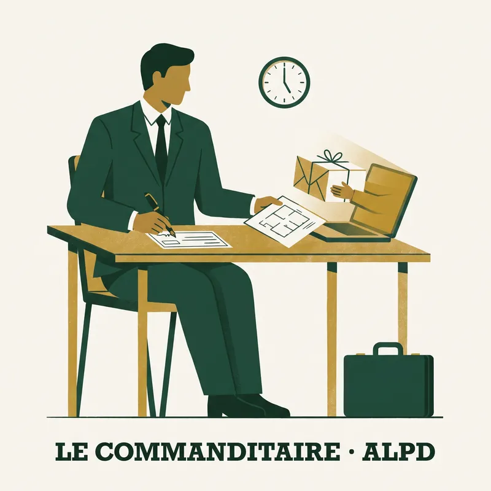</td><td>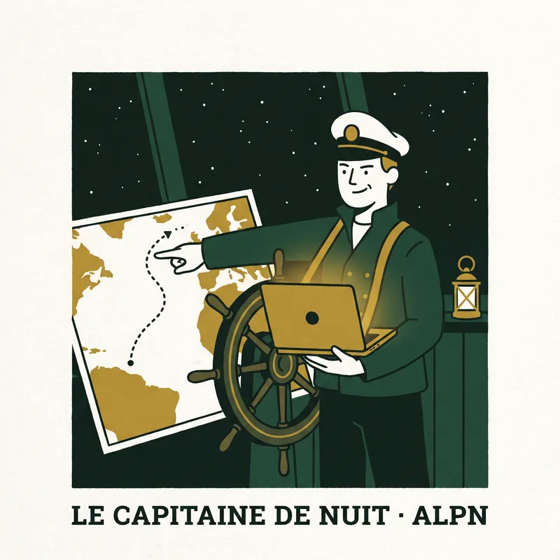</td><td></td><td>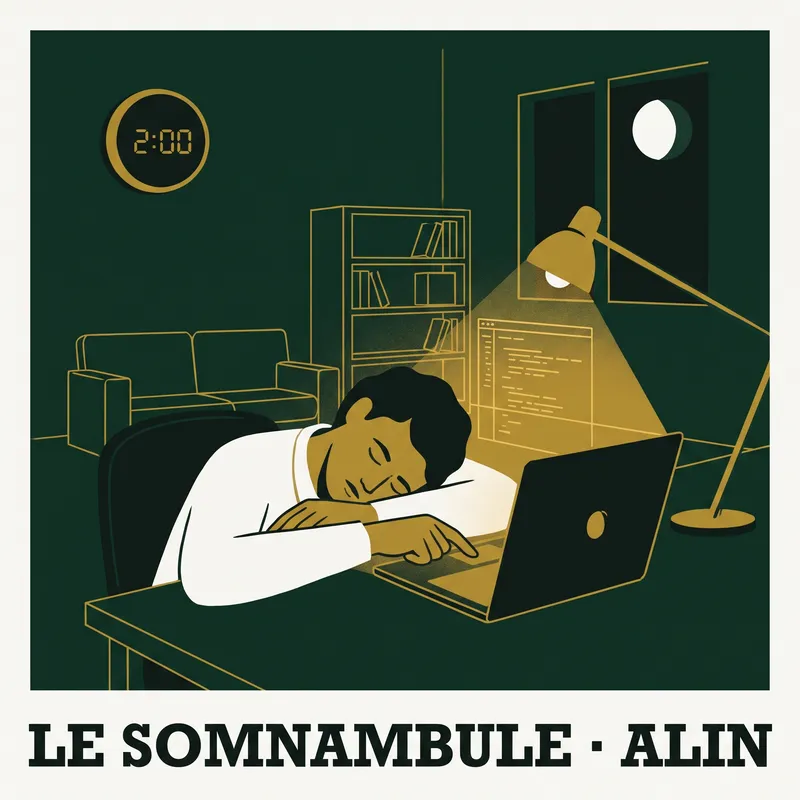</td></tr>
</table>

| Code | Français | English |
|---|---|---|
| CVPD | Le Contremaître | The Foreman |
| CVPN | Le Contremaître de nuit | The Night Foreman |
| CVID | Le Micro-manager bavard | The Chatty Micromanager |
| CVIN | Le Rédacteur insomniaque | The Insomniac Editor |
| CLPD | Le Chirurgien | The Surgeon |
| CLPN | Le Chirurgien de garde | The Night Surgeon |
| CLID | Le Tireur d'élite | The Sniper |
| CLIN | Le Veilleur | The Night Watch |
| AVPD | L'Architecte | The Architect |
| AVPN | L'Architecte noctambule | The Night Architect |
| AVID | Le Conteur | The Storyteller |
| AVIN | Le Somnambule bavard | The Chatty Sleepwalker |
| ALPD | Le Commanditaire | The Commissioner |
| ALPN | Le Capitaine de nuit | The Night Captain |
| ALID | Le Joueur de YOLO | The YOLO Player |
| ALIN | Le Somnambule | The Sleepwalker |

Les lettres, dans l'ordre : **C**ontrôle ou **A**utonomie (modes de permission, interruptions,
outils refusés), **V**erbeux ou **L**aconique (longueur médiane de vos messages, collages exclus),
**P**lanificateur ou **I**mpulsif (plan mode, ou un premier message de plus de 600 caractères),
**N**octurne ou **D**iurne (part de vos messages entre 21 h et 6 h, dans votre fuseau).

## Confidentialité, vérifiable

- Aucune requête ne quitte la page après son chargement. Ouvrez l'onglet Réseau et regardez : rien.
- Seuls des compteurs sont conservés : aucun prompt, aucune réponse, aucun chemin. Le JSON exporté ne
  contient que des nombres et des noms courts (modèles, outils, noms de dossiers). Un test l'impose.
- Pas de cookie, pas d'analytics, pas de police distante. Le fichier hors ligne marche câble débranché.
- Les transcriptions des sous-agents sont comptées et facturées, jamais lues comme *vos* messages :
  ces prompts-là, c'est Claude qui les a écrits.

## Comment ça marche

La page lit chaque `.jsonl` du dossier déposé, dans un Web Worker, ligne par ligne, et ne garde que
des agrégats. Les tokens sont dédoublonnés par message assistant (Claude Code écrit une ligne par bloc
de contenu, avec le même usage répété). Les marqueurs d'accord, d'excuse, de refus et d'interruption
sont des expressions régulières françaises et anglaises, listées dans `src/patterns.js`. Les prix
viennent de la grille API publique dans `src/pricing.js` ; la facture est une estimation, votre
abonnement ne fonctionne pas ainsi.

## En local

```bash
git clone https://github.com/Sandjab/ccti && cd ccti
npm install
npm test                 # tests unitaires, fixtures, garde-fou confidentialité
npm run build            # dist/ccti.html, la version fichier unique
npm run e2e              # Playwright, Chromium
node scripts/cli.mjs ~/.claude/projects --lang fr   # la même analyse depuis le terminal
```

Les heures sont calculées dans votre fuseau. Les marqueurs sont des heuristiques réglées sur des
conversations en français et en anglais ; les autres langues seront sous-comptées. Claude Code
uniquement, pour l'instant.

## Licence

MIT. Fait par [@Sandjab](https://github.com/Sandjab), avec Claude Code.
